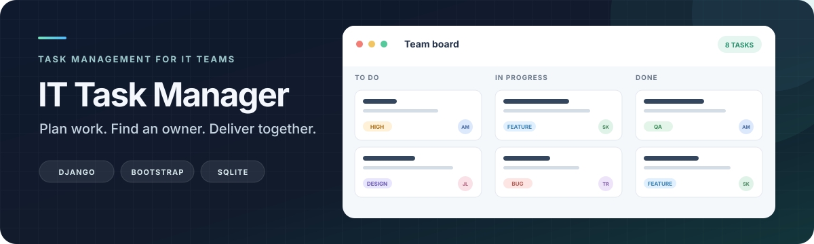

<p align="center">
  
</p>

<p align="center">
  A simple home for the work behind great software.<br>
  Create tasks, bring the right people in, and keep delivery moving.
</p>

<p align="center">
  <a href="#features">Features</a> ·
  <a href="#the-team-workflow">Workflow</a> ·
  <a href="#get-started">Get started</a> ·
  <a href="#data-model">Data model</a>
</p>

<p align="center">
  
  
  
  
</p>

## Built for the whole team

IT Task Manager gives developers, designers, project managers, and QA specialists one shared place to plan work. Every task has an owner, a priority, a deadline, and a clear status.

## Features

| Plan work | Bring people together | Keep work moving |
| --- | --- | --- |
| Create, edit, search, and filter tasks | Assign one or several team members | Mark tasks complete or reopen them |
| Set task type, priority, and deadline | Browse workers and positions | See completed and open work per person |
| Paginate long task lists | Manage team data in Django Admin | Track status from the task list |

## The team workflow

1. Add positions, workers, and task types in Django Admin.
2. Create a task and add its description, priority, and deadline.
3. Assign one or more team members.
4. Follow progress from the task list and each worker's page.

## Get started

<details>
<summary>Set up the project locally</summary>

### Requirements

- Python 3.12 or newer
- pip

### Install

```bash
git clone https://github.com/brit2pac/websiteproject.git
cd websiteproject
git switch develop
python3 -m venv .venv
source .venv/bin/activate
pip install -r requirements.txt
```

Create a local environment file and generate a private Django secret key:

```bash
cp .env.example .env
python -c 'from django.core.management.utils import get_random_secret_key; print(get_random_secret_key())'
```

Put the generated value in `SECRET_KEY` inside `.env`, replacing the example value. The local `.env` and SQLite database are excluded from Git.

Create the database, create an admin user, and start the server:

```bash
python manage.py migrate
python manage.py createsuperuser
python manage.py runserver
```

Open <http://127.0.0.1:8000/> and sign in. Add team members, positions, and task types at <http://127.0.0.1:8000/admin/>.

</details>

## Data model

`Worker` extends Django's `AbstractUser` and belongs to a `Position`. A `Task` has one `TaskType` and can be assigned to multiple workers. The editable schema is in the [database structure diagram](docs/database-structure.drawio).

## Project layout

```text
config/      Django project configuration
tasks/       models, forms, views, URLs, and templates
docs/        banner artwork and database diagram
```
